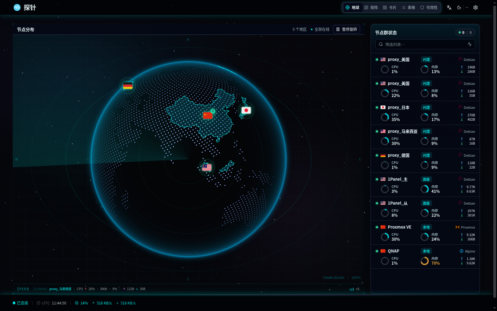
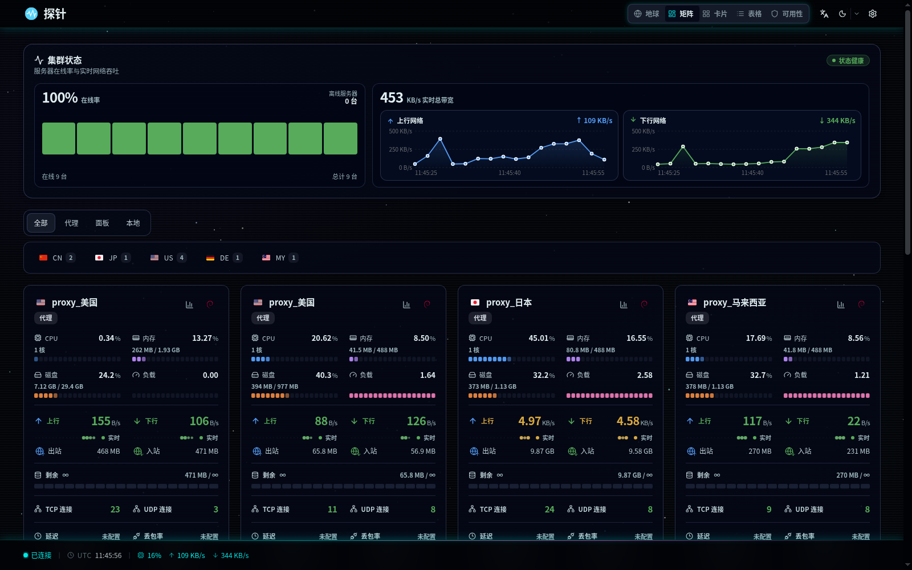
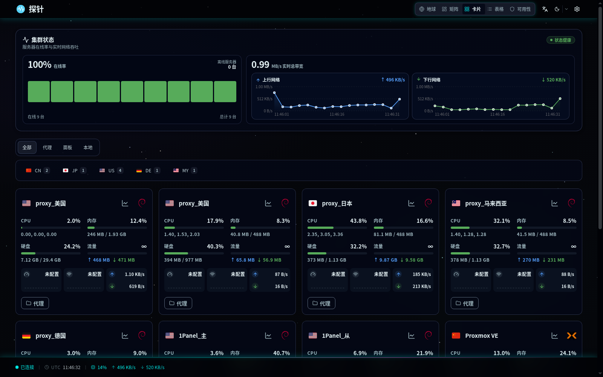
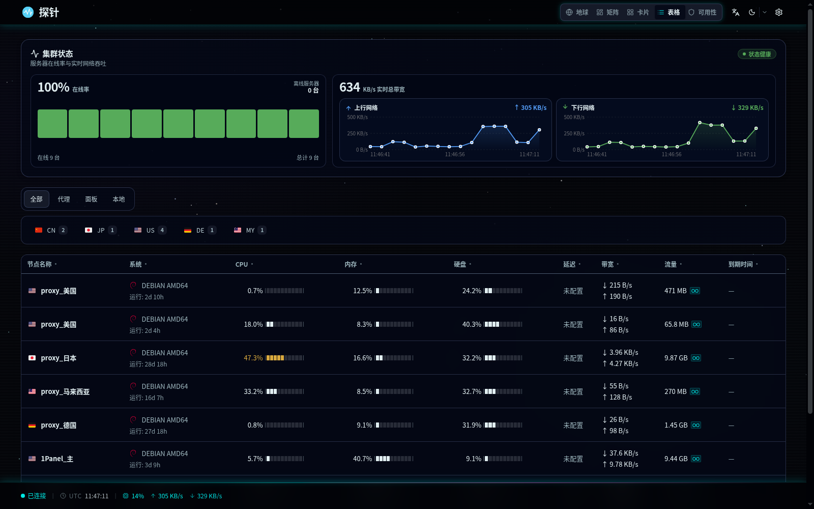
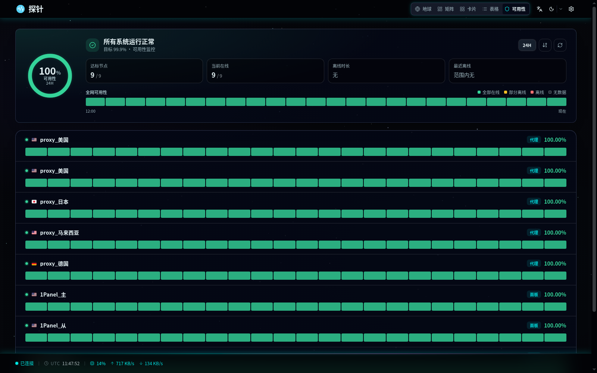
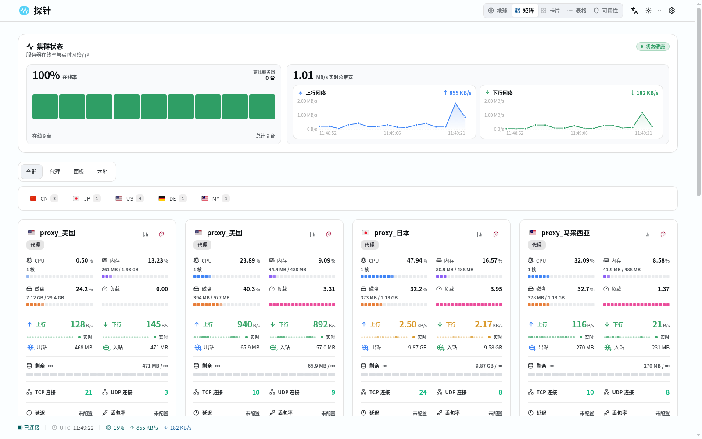
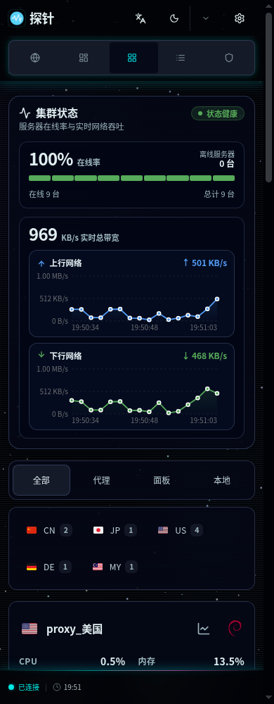

# komari_TacitSoul

Tacit Soul 是 [Komari](https://github.com/komari-monitor/komari) 的第三方监控主题，提供节点资源监控、网络流量展示和可用性统计，支持桌面与移动端访问。

当前版本：`v1.0.1` · 适配版本：Komari `1.6.1` · 许可证：[MIT](LICENSE)

[在线演示](https://agent.52dh.com.cn/) · [下载主题](https://github.com/TacitSoul/komari_TacitSoul/releases) · [界面预览](#效果展示)



## 主要功能

- **节点视图**：地球、矩阵、卡片、表格和可用性五种展示方式。
- **资源监控**：CPU、内存、磁盘使用率及实时上下行速率。
- **网络统计**：延迟、丢包、流量统计，支持单线路与三网模式。
- **可用性统计**：节点在线率、离线时长和历史状态。
- **节点管理展示**：分组筛选、地区筛选、排序及大列表虚拟滚动。
- **外观设置**：简洁、深空两套配色，支持跟随系统；站点图标沿用 Komari 后台配置。
- **多语言**：简体中文、繁体中文和 English。

## 效果展示

截图来自 [演示站点](https://agent.52dh.com.cn/)，拍摄于 2026 年 11 月 16 日。监控数据以站点实时状态为准。

### 深空主题

| 矩阵视图 | 卡片视图 |
| --- | --- |
|  |  |
| **表格视图** | **可用性视图** |
|  |  |

### 简洁主题



### 移动端

390 px 视口下的卡片视图，使用浏览器移动设备模拟。

<p align="center">
  
</p>

[查看原图及截图说明](docs/screenshots/README.md)

## 安装

1. 在 [Releases](https://github.com/TacitSoul/komari_TacitSoul/releases) 下载 `TacitSoul-v1.0.1.zip`。
2. 进入 Komari 后台的主题管理页面，上传安装包并启用。
3. 通过后台菜单中的 **Tacit Soul 主题设置** 调整视图、配色及显示选项。

请使用 Release 附件中的主题安装包，GitHub 自动生成的 Source code 压缩包不能直接安装。

## 使用说明

- 主题设置需要管理员登录，且当前启用的主题须为 Tacit Soul。
- 各视图默认沿用 Komari 后台的服务器顺序；表格排序等手动操作不受影响。
- 延迟与丢包展示需要配置监测线路，未配置时显示相应提示。
- 浏览器标签图标和页面 Logo 使用 Komari 后台设置的站点图标。
- 主题设置对访客公开可读，请勿在其中保存密钥或其他私密信息。
- 更新主题后，如页面仍显示旧内容，可刷新或重新打开标签页；已安装的 PWA 需接受更新后重开。

## 本地开发

环境要求：Node.js 24、pnpm 10.18.0。

```bash
pnpm install --frozen-lockfile
cp .env.example .env.development.local
```

在 `.env.development.local` 中配置 `VITE_API_TARGET`。连接实际 Komari 实例时，建议使用项目提供的只读网关。

```bash
# 启动只读网关，默认上游为 http://127.0.0.1:25774
# 其他地址可通过 KOMARI_UPSTREAM 指定
pnpm run gateway

# 在另一个终端启动开发服务器，默认地址为 http://127.0.0.1:5174
pnpm run dev
```

只读网关默认监听 `127.0.0.1:25780`，过滤认证信息并限制可访问的接口。该网关不转发 WebSocket，主题在此模式下使用 HTTP 轮询。

```bash
pnpm run test       # 单元测试
pnpm run lint       # 代码检查
pnpm run package    # 构建并生成主题安装包
```

构建产物位于 `dist/`，安装包 `TacitSoul-v<版本>.zip` 生成在项目根目录。架构说明见 [docs/ARCHITECTURE.md](docs/ARCHITECTURE.md)。

## 项目结构

| 路径 | 内容 |
| --- | --- |
| `src/` | React / TypeScript 源码 |
| `public/` | 国旗、系统图标及 PWA 资源 |
| `scripts/` | 打包、图标生成与开发网关脚本 |
| `docs/` | 架构文档与界面截图 |
| `komari-theme.json` | Komari 主题元数据 |
| `.github/workflows/` | 测试与发布工作流 |

## 许可证

本项目采用 [MIT License](LICENSE)。
