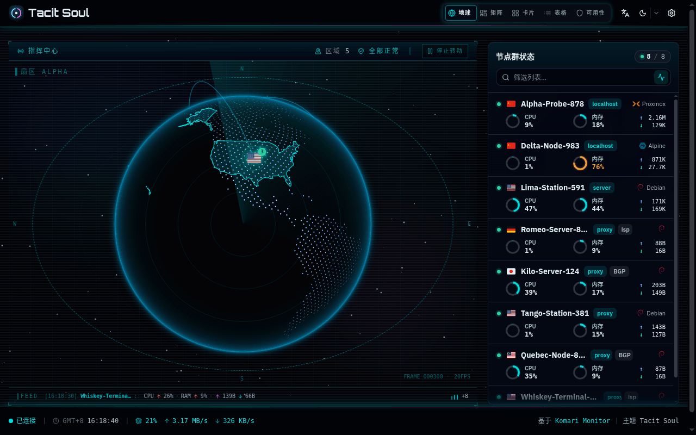

# komari_TacitSoul主题

[Komari Monitor](https://github.com/komari-monitor/komari) 主题。功能完善的 Komari 监控主题。
当前版本：**v1.0.0** · 适配 **Komari 1.6.1**。

这是整理后的独立项目首发版本，统一版本号为 `v1.0.0`；主题标识仍为 `TacitSoul`，保留现有功能与兼容性。



## 功能

- **五种视图**：地球 / 矩阵 / 卡片 / 表格 / 可用性。可在设置里选默认视图；地球、矩阵、可用性可以单独关闭。
- **两套配色**：简洁（浅色）、深空（深色），或跟随系统。
- **地球**：底座原版的点阵地球（cobe，雷达扫描、光环）上叠加国旗标记、有节点的国家高亮、
  连向"中枢节点"的飞线；点列表或国旗，地球转过去并弹出地区卡片。右侧节点群每行两层：
  国旗、名称、标签、系统；CPU / 内存圆环与实时速率。
- **矩阵**：大卡片——SVG 国旗、分段指标条、延迟与丢包柱、今日流量浮窗、三网模式。
- **卡片**：卡片风格——2×2 资源胶囊条、近 1 小时延迟 / 丢包曲线、实时速率、标签与到期价格。
- **表格**：10 段括号条、延迟历史色块、流量统计方式角标；可排序，大列表虚拟滚动。
- **可用性**：按实际在线时长计算（不是"有记录就算整格在线"），节点加入前的时段记为"无数据"；
  请求失败时显示错误与重试，不会算成宕机。
- **集群状态**：在线率、每台一格的状态块、实时总带宽与上下行曲线。
- **分组标签 + 地区条**（国旗 + 数量）：卡片、矩阵、表格共用；管理员登录后可在桌面端拖动排序。
- **一套延迟设置**：单线路绑定或三网模式只配置一次，矩阵、卡片、表格都读同一份数据；
  未绑定的节点显示"未配置"，不会出现模拟数据。
- **三种语言**：简体中文、繁體中文、English。

## 安装

1. 从 [Releases](https://github.com/TacitSoul/komari_TacitSoul/releases) 下载 `TacitSoul-v1.0.0.zip`（安装包，不要下载 GitHub 自动生成的 Source code 压缩包）。
2. Komari 后台 → 主题管理 → 上传 zip 并启用。
3. 后台菜单里会出现 **Tacit Soul 主题设置**，所有设置都在这个页面完成（需要管理员登录，且当前启用的主题是 Tacit Soul）。
   保存时先读取服务器上的最新设置，只写入你改过的项，不会覆盖其他地方保存的设置。

主题设置对访客公开可读，不要在里面填写任何密钥或私密信息。

### 地球节点列表标签对齐

节点名称列按当前授权节点列表中最宽名称的实际字体宽度统一，分组标签纵向对齐；搜索和滚动不会因为最长名称暂时不在屏幕内而移动列位置。无国旗或无分组仍保留对应列的位置，小屏和超长名称使用省略保护，完整名称保留悬停提示。仅调整列表排版，不改变地球、排序、指标和微软雅黑优先字体。

### 整体界面与字体

全站优先使用客户端本机安装的 `Microsoft YaHei`（微软雅黑），中文回退为 Microsoft YaHei UI / PingFang SC / Hiragino Sans GB / Noto Sans CJK SC / 系统字体。普通界面、数字、矩阵、表格、状态栏和提示使用同一字体栈；只有代码/命令段保留等宽字体。主题不分发微软雅黑字库，也不会把其他字体改名冒充；没有安装微软雅黑的手机或 Linux 设备会正常回退。

移除原 Google 字体请求和 Inter 字库导入；导航、卡片、筛选、表格、侧栏和可用性面板统一边框、圆角与字体层级。手机端把工具按钮放到标题右侧、视图切换独立一行，增加触控面积。地球渲染、指标计算、告警色、接口和后台顺序保持不变。

### 地球视图信息栏

顶部改为简洁的“节点分布 / 实际地区数 / 在线或异常状态”，配色、字体和按钮与其他监控面板统一。旋转控制文案为“暂停旋转 / 继续旋转”，动作沿用原逻辑；移除没有实际含义的“扇区 ALPHA”装饰。地球渲染、配色、国旗、连线、动画速度及点击交互保持原样。

### 服务器顺序

地球、矩阵、卡片、表格、可用性视图默认跟随 Komari 后台服务器列表：按后台权重升序，同权重保留后台原列表顺序，不按 UUID 重新排列。主题使用 `public:getNodesInformation` 的有序数组恢复 `common:getNodes` 的 UUID 映射顺序；主接口授权范围及元数据不变。

地球看板默认不再按实时活跃度重排。旧版默认开启的活跃度偏好不会自动沿用；若手动开启活跃度排序，可再次关闭以恢复后台顺序。表格列排序和可用性排序仍是手动功能。返回页面或页面保持可见时，主题会重新读取服务器元数据；后台调整权重后不用重装主题。

### 自定义站点图标

在 Komari 后台上传自定义 Favicon 后，浏览器标签图标和网页标题左侧 Logo 会共同读取后端 `/favicon.ico`，桌面端、手机端及亮暗模式保持一致。支持后端接受的 PNG 等格式，无需把 PNG 手动改成 ICO。

主题不再以自带 SVG 覆盖站点图标，也不再把后台图标写入 PWA 预缓存。升级后若仍显示旧图，请强制刷新或关闭旧标签页再打开；已安装的 PWA 请接受更新后重开。PWA 桌面快捷方式和 Apple touch icon 仍使用主题原有图标。

## 开发

需要 Node.js 24 与 pnpm 10.18.0（版本固定在 `package.json` 的 `packageManager` 字段中；如环境提供 Corepack，可运行 `corepack enable`）。

```bash
pnpm install --frozen-lockfile
cp .env.example .env.development.local   # 按需修改 VITE_API_TARGET
pnpm run gateway   # 只读网关：127.0.0.1:25780 -> 你的 Komari（默认 127.0.0.1:25774，可用 KOMARI_UPSTREAM 指定）
pnpm run dev       # http://127.0.0.1:5174
```

开发服务器把 `/api` 代理到 `VITE_API_TARGET`。连真实站点时请指向只读网关：它会去掉 Cookie / Authorization，
只放行访客可读的接口和只读 RPC 方法，其余请求在网关就被拒绝，所以开发中的主题无法改动线上实例。
网关不转发 WebSocket，主题会自动改用 HTTP 轮询。

```bash
pnpm run test      # 单元测试
pnpm run lint
pnpm run package   # 构建并生成 TacitSoul-v<版本>.zip（komari-theme.json + preview.png + dist/ + LICENSE）
```

`src/matrix/` 下为矩阵视图代码（CSS 变量使用 `--ts-` 前缀，界面文字通过 `tsText()` 支持三种语言）。
架构说明见 [`docs/ARCHITECTURE.md`](docs/ARCHITECTURE.md)。

## 项目结构

- `src/`：React / TypeScript 主题源码。
- `public/`：国旗、系统图标及 PWA 资源。
- `scripts/`：打包、图标生成与本地只读网关工具。
- `komari-theme.json`：Komari 主题元数据，版本与 `package.json` 保持一致。
- `.github/workflows/`：自动测试、构建及 Release 发布。
- `RELEASE-NOTES.md`：当前版本发布说明。

构建产物 `dist/`、依赖目录、安装包以及本地环境变量不提交到源码仓库；安装包在 Releases 提供。

## 许可证

使用 [MIT License](LICENSE)，保留原有版权声明。
